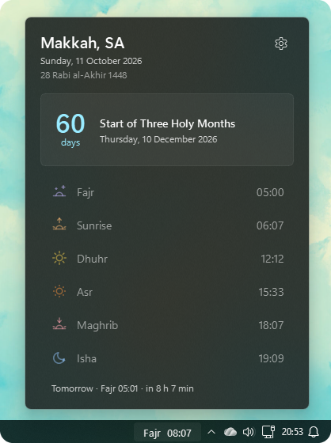
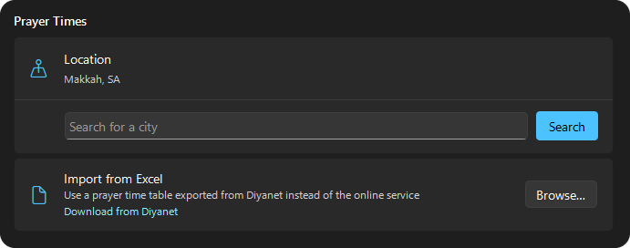
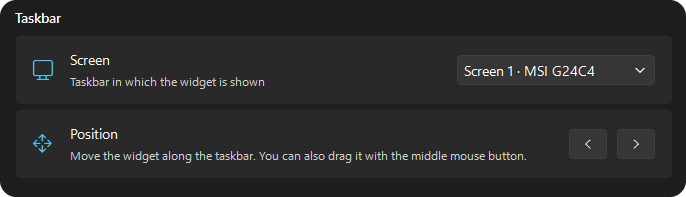
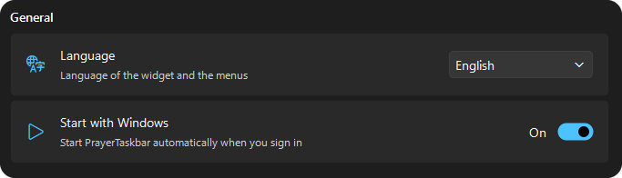

[English](README.md) · **Türkçe** · [Deutsch](README.de.md)

<picture>
  <source media="(prefers-color-scheme: dark)" srcset="./.github/assets/logo-white.png">
  
</picture>

# PrayerTaskbar

### Namaz vakitleri doğrudan Windows görev çubuğunuzda
PrayerTaskbar, bir sonraki namaza kalan süreyi saatin hemen yanında gösterir. Tek tıkla bugünün namaz vakitlerini ve sıradaki mübarek günü görürsünüz.

## İndir

*Kurulum dosyasını çalıştırın, PrayerTaskbar görev çubuğunuzda görünür.* 
*Windows bir SmartScreen uyarısı gösterirse "Ek bilgi"ye ve ardından "Yine de çalıştır"a tıklayın.*

## Özellikler

- **Görev çubuğunda geri sayım:** Bir sonraki namaza kalan süre, saatin hemen yanında. Son 15 dakikada kırmızıya döner.
- **Bugün tek bakışta:** Tek tıkla bugünün tüm namaz vakitleri, sıradaki namaz vurgulanmış olarak.
- **Sıradaki mübarek gün:** Ramazan veya bayram gibi bir sonraki mübarek güne kaç gün kaldığını görün.
- **Şehriniz:** Şehrinizi arayın, namaz vakitleri Diyanet'ten yüklenir.
- **Windows 11 için tasarlandı:** Açık ve koyu moda ve vurgu renginize uyum sağlar.
- **Üç dil:** İngilizce, Türkçe ve Almanca.
- **Otomatik güncellemeler:** Yeni sürümler uygulama başlarken kendiliğinden yüklenir. Bunu kapatırsanız uygulama yalnızca haber verir.

## Ayarlar

Şehrinizi seçin veya Diyanet'ten bir namaz vakti tablosu içe aktarın.

Ekranı seçin ve widget'ı görev çubuğunda kaydırın.

Dili değiştirin ve PrayerTaskbar'ı Windows ile başlatın.

### Teşekkürler

Namaz vakitleri [Diyanet](https://namazvakitleri.diyanet.gov.tr)'ten, [abdus.dev Diyanet API](https://prayertimes.api.abdus.dev/) aracılığıyla sağlanır.

### Lisans

[MIT Lisansı](/LICENSE) ile yayınlanmıştır.

